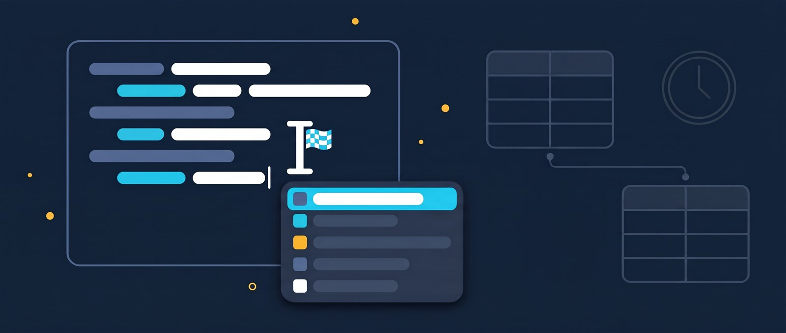

<p align="center"></p>

<h1 align="center"><br>SQLFinish</h1>

<p align="center">Fast SQL completion, query building, formatting, query history, Excel export and query windows that are still there after a restart, for SQL Server Management Studio 22.10 or later.<br>Free, small, and it stays on your machine.</p>

<table>
  <tr>
    <td align="center" width="25%"><br><b>Completion</b><br>Tables, columns and procedures from your own database</td>
    <td align="center" width="25%"><br><b>Joins written for you</b><br>From foreign keys, or guessed from column names</td>
    <td align="center" width="25%"><br><b>Pick columns</b><br>Tick the ones you want instead of typing them</td>
    <td align="center" width="25%"><br><b>Query history</b><br>Every script you ran, searchable</td>
  </tr>
  <tr>
    <td align="center"><br><b>Format</b><br>One keystroke, comments and strings untouched</td>
    <td align="center"><br><b>Execute guard</b><br>Asks before an <code>UPDATE</code> or <code>DELETE</code> with no <code>WHERE</code></td>
    <td align="center"><br><b>Open definition</b><br>F12 on a procedure opens it ready to alter</td>
    <td align="center"><br><b>Private</b><br>No telemetry, no account, nothing leaves your machine</td>
  </tr>
</table>

```sql
SELECT * FROM Orders o JOIN            -- the list offers:  Customers c ON o.CustomerId = c.Id
```

An original implementation: it contains no code from, and is not affiliated with, any other SSMS add-in.

## Why it exists

SSMS is free. The add-ins that make it quick to type in are not. The well-known ones are sold per developer, usually as a yearly subscription, and they bundle a long list of features around the two things most people actually open them for: a completion list that knows the database, and a fast way to put a query together.

That is a lot to pay, for every seat on a team, to have `FROM Orders o JOIN` finish itself. SSMS's built-in IntelliSense completes names, but it does not write join conditions, add aliases or expand `*`, so the choice has been a subscription or typing it all out.

SQLFinish is the small version. It does the handful of things that save keystrokes all day and stops there:

- one DLL of under 200 KB, with no account, licence key or trial period;
- no telemetry and no network calls of its own: it reads the catalog over the connection your query window already has, and writes only to your own profile folder;
- source you can read in an afternoon, and change when it does not suit you.

If you need refactoring suites, data generators or source control integration, the commercial tools earn their price. If you want your joins written and your scripts remembered, this is enough.

## Install

1. Download [SQLFinish-Setup.zip](dist/SQLFinish-Setup.zip) (use the download button on that page) and extract it.
2. Close SSMS.
3. Double-click `Install.cmd`.

Start SSMS again and the commands are under **Tools > SQLFinish**. Nothing needs administrator rights; it installs for your Windows user only.

To remove it, run `Install.cmd -Uninstall` from a command prompt in the extracted folder.
The zip also holds `SQLFinish.vsix`, which can be double-clicked instead where `.vsix` files are associated with the Visual Studio installer.

## Features

###  Completion and query building

Suggestions come from the catalog of the database the query window is connected to. Tab or Enter accepts one; typing a space, a dot or other punctuation closes the list without inserting anything.

- **Tables and views** after `FROM` / `JOIN` / `INTO` / `UPDATE`, inserted with an alias (`Orders o`).
- **Whole joins** after `JOIN`: `Customers c ON o.CustomerId = c.Id`, one for each foreign key to or from the tables already in the statement.
- **The next clause** once a table has its alias: `INNER JOIN`, `LEFT JOIN`, `CROSS APPLY`, `WHERE`, `GROUP BY`, `ORDER BY` and so on. After a condition, `AND`, `OR` and the next clause are offered as you type.
- **Join conditions** straight after a joined table (`ON o.CustomerId = c.Id`) and after `ON`. They come from foreign keys; where the database declares none, they are guessed from column names (`Customers.Id` = `Orders.CustomerId`, or a column ending in `Id` that both tables have).
- **Columns** after `alias.`, and in `SELECT` / `WHERE` / `ON` / `ORDER BY` / `GROUP BY`. With several tables in the statement they are alias-qualified (`o.Total`) but still found by typing the column's own name. The list opens by itself on the space after `WHERE`, `AND`, `OR`, `HAVING`, `ORDER BY` and `GROUP BY`.
- **Procedures** after `EXEC`, **databases** after `USE`, **schema objects** after `schema.`, built-in functions and keywords.
- **Snippets** at the start of a statement: `ssf` → `SELECT * FROM `, and `st100`, `scf`, `ii`, `df`, `bt`, `be`, `tc`, `ct`, `cp`.
- **Tab after `*`** (or `alias.*`) in a select list replaces it with the column list and re-formats that statement, one column per line.

The list never opens by itself after a table that has no alias yet, or after a column in a select list, so typing an alias is never hijacked. Ctrl+Space opens it there.

A statement ends at `;` or `GO`. A forgotten `;` is forgiven: leave a blank line and what you type next is a new statement, with suggestions of its own and none of the tables above it. A blank line before the next clause (`FROM`, `WHERE`, `JOIN`, `UNION` and so on), after a comma, or inside parentheses does not end the statement.

###  Query history

Every script you execute is remembered with its time, server and database, so the query you ran last Tuesday is not lost with the tab you closed.

- **Open it** with Ctrl+K, Ctrl+Q, or Tools > SQLFinish > Query History.... With no query window open it still opens, offering Copy only.
- **Find a script** by typing: the list filters on the script text, server and database, newest first, and the selected script is shown in full underneath. The box beside it narrows the list to one server and database.
- **Use it**: Enter or double-click inserts the script at the caret (over the selection, if there is one); Copy puts it on the clipboard.
- **Pin** the scripts you reuse: a pinned script is listed first, marked ★, and is never removed to make room for newer ones.
- **Forget** a script with Delete (the button, or the Delete key with a script selected in the list). **Clear...** asks, then deletes every script the filters are showing except the pinned ones: all of them, or just one server's, or just those matching what you typed.
- **What is kept**: the last 1000 executed scripts (change the number under Options) plus the pinned ones, as plain `.sql` files in `%LOCALAPPDATA%\SQLFinish\History`. Executing a selection records the selection. Running the same script twice in a row is recorded once, and scripts over a million characters are not recorded.
- **What that means for you**: the files hold whatever you ran, including any passwords or data typed into a script. They never leave your machine. To keep them somewhere else, set the environment variable `SQLFINISH_HISTORY` to a folder before starting SSMS.

###  Commands (Tools > SQLFinish)

| Command | Shortcut | What it does |
| --- | --- | --- |
| Format SQL | Ctrl+K, Ctrl+Y | Formats the selection, or the whole script. Only whitespace and keyword case change (checked before the editor is touched); comments and strings are kept as they are. |
| Pick Columns... | Ctrl+K, Ctrl+J | A list of the columns of the statement's tables with tick boxes, at the caret. Type to filter, Space ticks, Ctrl+A ticks all shown, Enter inserts them and re-formats that statement. Used straight after `*`, `alias.*` or `alias.` it replaces that text. Also the first entry of every column list. |
| Query History... | Ctrl+K, Ctrl+Q | Opens the history described above. |
| Open Definition | F12 | With the caret in the name of a stored procedure, view, function or trigger: opens it in a new query window on the same connection as an `ALTER` script, starting with `USE` for its database and the `ANSI_NULLS` / `QUOTED_IDENTIFIER` settings it was created with. |
| Refresh Suggestions | Ctrl+K, Ctrl+R | Reloads the catalog. Executing a script that contains `CREATE`, `ALTER`, `DROP` or `sp_rename` does this by itself. |
| Export to Excel... | Ctrl+K, Ctrl+O | Opens the results in Excel: see below. Greyed out until the query window has a grid with rows. |

The same commands are on the **SQLFinish toolbar**, which appears whenever a query window is active, like SSMS's own SQL Editor toolbar. Right-click the toolbar area to switch it off, or drag it where you want it.

Shortcuts can be changed under Tools > Options > Environment > Keyboard, where the commands are listed as `Tools.FormatSQL`, `Tools.PickColumns`, `Tools.QueryHistory`, `Tools.OpenDefinition`, `Tools.ExporttoExcel` and `Tools.RefreshSuggestions`.

### Export results to Excel

Click the Excel button on the toolbar, press Ctrl+K, Ctrl+O, or right-click a results grid and choose **Export to Excel...**, straight under SSMS's own Save Results As. The whole grid opens in Excel as an `.xlsx` workbook; nothing is asked first. From the toolbar, the shortcut or the Tools menu it is the window's first results grid; click in another grid first to export that one.

The workbook Excel shows is a temporary, read-only copy (in `%TEMP%\SQLFinish`, cleared out after a week), so Save in Excel asks where to keep it and closing Excel without saving leaves nothing behind. To choose the file before it is written instead, switch on **Ask where to save** under Options.

- **The header row** is bold white on dark blue, stays in view as you scroll, and has the filter switched on.
- **Every column is formatted for its SQL type**, so Excel sorts, filters and sums it properly:

  | SQL type | In Excel |
  | --- | --- |
  | `tinyint`, `smallint`, `int`, `bigint` | whole numbers |
  | `decimal`, `numeric` | numbers with the column's own scale (`decimal(10,2)` shows `12.50`) |
  | `money`, `smallmoney` | numbers with thousands separators (`1,234,567.89`) |
  | `float`, `real` | numbers |
  | `date`, `datetime`, `datetime2`, `smalldatetime` | real dates, shown as `yyyy-mm-dd` with the time where the type has one |
  | `time` | times |
  | `bit` | `TRUE` / `FALSE` |
  | everything else | text, as SSMS shows it |

- **`NULL` is an empty cell**, not the word NULL.
- **Nothing is silently changed.** Excel keeps 15 significant digits and has no dates before March 1900, so a longer `bigint` or `decimal`, an earlier date, and `datetimeoffset` are written as text, exactly as SSMS shows them.
- **Excel's own limits apply**: 1,048,575 rows and 32,767 characters in a cell. The status bar says so when a result was cut to fit.

It writes the file itself: Excel does not need to be installed to export, only to open the result.

### Your query windows, still there after a restart

Close SSMS with query windows open and they are back the next time it starts: every window, with its text, whether you ever saved it or not.

- **A query you never saved** comes back as a new query window holding exactly what you had typed. Answer "Don't Save" when SSMS asks on the way out; the text is already kept.
- **A saved file** comes back as that file. If it had changes you had not saved, it comes back as a new query holding the changed text instead, so nothing typed is lost and the file is left as it was.
- **Connections** are remembered the way SSMS itself writes them down: server, database, kind of login and user name, never a password. Each window reconnects as SSMS does for a window opened with a known connection: silently for Windows and Entra logins, through SSMS's own Connect dialog, already filled in, where a password is needed. If a server does not answer, the other windows for it come back unconnected rather than each waiting in turn.
- **A window you closed yourself** stays closed. (Closed within the last half minute before SSMS itself was closed, it may come back once.) Empty windows are not brought back.
- **Several SSMS windows at once** each have their own set, and a crash is covered as well as a normal close: the windows are noted every few seconds, not only on the way out.
- **Where it is kept**: `%LOCALAPPDATA%\SQLFinish\Session`, as plain `.sql` files, or the folder named by the environment variable `SQLFINISH_SESSION`. A set of windows that could not all be reopened is left there in a folder ending `.failed` rather than deleted.

###  Execute guard

Running a script (F5) that has an `UPDATE` or `DELETE` with no `WHERE` asks first, listing each one with its line. "No" is the default answer. Temp tables and table variables are exempt.

### Options (Tools > Options > SQLFinish)

| Option | Default | What it does |
| --- | --- | --- |
| Blank line ends a statement | on | Off: only `;` and `GO` end a statement. |
| Ask when there is no WHERE | on | The execute guard. |
| Remember executed scripts | on | Off: nothing new goes into the query history; what is there stays. |
| Scripts kept | 1000 | How many scripts the history holds before the oldest are deleted. |
| Ask where to save | off | On: Export to Excel asks for a file first, instead of opening a temporary workbook. |
| Reopen query windows | on | Off: no windows are remembered, and what was remembered is thrown away at the next start. |

SSMS 22 lists the page under Tools > Options > SQLFinish and opens it in its older Options dialog.

##  Privacy

SQLFinish has no telemetry, no update check and no network code. It talks to SQL Server only, through a connection opened with the credentials of the query window you are typing in, to read catalog views and object definitions. It writes to four places of its own, all in your Windows profile: the query history folder and the session folder above (what you ran, and the text of the windows you have open), temporary workbooks in `%TEMP%\SQLFinish`, and the log below. No password is written anywhere.

## Troubleshooting

Failures to read the connection or the catalog are shown in the status bar and written to `%TEMP%\SQLFinish.log`.
Set the environment variable `SQLFINISH_TRACE=1` before starting SSMS to also log every completion step there.

The log names servers, databases and columns. Read it before attaching it to a public issue.

## Known limits

- A large catalog takes a few seconds to read the first time; until then the list holds keywords only (the status bar says so).
- Columns are offered for tables and views named in the statement. CTEs, derived tables, temp tables and table variables have none yet.
- Join conditions guessed from column names cover two naming habits only (see above); a foreign key always wins.
- The execute guard reads the script text: SQL built in strings, or run from procedures, is not seen.
- Statements are separated on `;`, `GO` and blank lines only, so unterminated statements with no blank line between them share one alias scope.
- Open Definition shows the source as SQL Server stores it, so an object renamed with `sp_rename` still carries its old name in the script.
- One fixed formatting style (4 spaces, upper-case keywords, one select item per line).
- Export to Excel writes the whole grid, not the selection, and one grid at a time. Dates and times are kept to the millisecond, the finest Excel shows. Column widths are sized from the first 200 rows.
- Reopened windows come back in the order they were first opened, as ordinary tabs: tab groups, pinned tabs, the caret position and results are not restored. A query over five million characters is not kept. Windows that are not SQL query windows (XML, plans, designers) are not reopened.
- It reaches the query window's connection, the way query windows are reopened, the results grid and its right-click menu through SSMS internals that are not a supported extension API. An SSMS update can break that; the result is a keywords-only list or a missing menu item, and a line in the log, not a crash.

##  Roadmap

Proposals through the end of 2027, in the order they are most likely to be built. This is a plan, not a promise: issues and pull requests can move things up.

| When | Version | Proposed |
| --- | --- | --- |
| Q1 2027 | 1.10 | Tagged GitHub Releases with the installer attached. **Columns from everywhere**: CTEs, derived tables, temp tables and table variables. Statement boundaries found with neither `;`, `GO` nor a blank line. |
| Q2 2027 | 1.11 | **More options**: history exclusions (for example, never record scripts run against a named server), a switch for each remaining feature, and formatting style (indent, keyword case, comma placement). **Your own snippets**, read from a file. |
| Q3 2027 | 1.12 | **More query building**: `INSERT` with its column list and a matching `VALUES` row, `EXEC` with the procedure's parameters, and join suggestions learned from the joins already in your history. **Column details** (type, nullability, key) beside each suggestion. Open Definition for tables. |
| Q4 2027 | 2.0 | **Wider guard**: `TRUNCATE`, `DROP`, and a confirmation for servers you mark as production. **History with results**: how long each script ran and how many rows it affected. Find any object in the catalog by name. |

Not planned: telemetry, accounts, cloud sync, or anything that sends a script off your machine.

## Version history

| Version | What changed |
| --- | --- |
| 1.9 | Query windows are reopened, with their text and connection, when SSMS starts again. A SQLFinish toolbar. Export to Excel opens the workbook straight away instead of asking for a file name first. |
| 1.8 | History you can manage: pin scripts so they are never pruned, delete one, clear what is listed, and filter by server and database. |
| 1.7 | Shortcuts for Export to Excel (Ctrl+K, Ctrl+O, also from the query text) and Refresh Suggestions (Ctrl+K, Ctrl+R). An options page. A blank line ends a statement that was left without its `;`. |
| 1.6 | Export to Excel from the results grid's right-click menu: a coloured, frozen header row with the filter on, and every column formatted for its SQL type. |
| 1.5 | The next clause is offered after an aliased table, and the join condition after a joined table. Join conditions are guessed from column names when there are no foreign keys. Columns are found by their own name when alias-qualified. One-file installer. |
| 1.4 | Query History. Open Definition on F12. The column list opens on the space after `ORDER BY`, `WHERE` and friends. Picked columns are laid out by the formatter. The menu moved to Tools > SQLFinish, where SSMS 22 actually shows it. |
| 1.3 | Tab after `*` re-formats the statement, one column per line. |
| 1.2 | Pick Columns. |
| 1.1 | Tab after `*` expands the column list. Execute guard for `UPDATE` / `DELETE` without `WHERE`. The catalog reloads after a schema change. |
| 1.0 | Completion from the catalog (tables with aliases, joins from foreign keys, columns, procedures), the formatter and snippets. |

## Building from source

`.\build.ps1` runs the engine self-check, then writes `dist\SQLFinish.vsix` and `dist\SQLFinish-Setup.zip` (the vsix with its install script). Commit the zip to publish a new version: it is the only file under `dist` that is tracked.
Needs the .NET SDK and Visual Studio's MSBuild (any edition; the VS SDK workload is not required).

- `src\Engine` - tokenizer, formatter, completion, catalog query, history, session store, Excel writer. Plain C#, no SSMS dependencies.
- `src\Vs` - the SSMS side: completion source (MEF), menu package, dialogs, and `Ssms.cs`, the one file that reaches into SSMS's own assemblies (by reflection) for the query window's connection and the results grid.
- `check` - `dotnet run --project check`: asserts on the engine, plus the catalog queries against LocalDB when present.

Bug reports are most useful with the SSMS version (Help > About) and the statement you were typing, with the caret position marked.

## License

[MIT](LICENSE): free for anyone to use, change and share, at work or at home, with no warranty.
